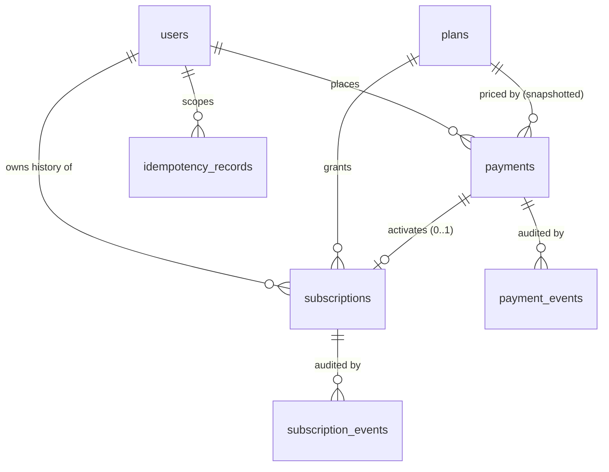

# Entity Relationship Design

## Cardinalities (all enforced by the database)

| Relationship | Rule | Enforcement |
|---|---|---|
| user → payments | 1 : N | `payments.user_id` FK (RESTRICT) |
| user → subscriptions | 1 : N (history) | `subscriptions.user_id` FK (RESTRICT) |
| plan → payments / subscriptions | 1 : N | FKs (RESTRICT); plans are deactivated (`is_active`), never deleted while referenced |
| payment → payment_events | 1 : N | `payment_events.payment_id` FK |
| payment → subscription | **1 : 0..1** | `UNIQUE(subscriptions.payment_id)`; a subscription cannot exist without its payment (NOT NULL FK) |
| subscription → subscription_events | 1 : N | FK |

All foreign keys are `ON DELETE RESTRICT`: nothing cascades away financial history. DELETE on `payments`,
`subscriptions`, `payment_events`, `subscription_events` is additionally blocked by triggers.

## Decision: history vs. "one current subscription"

**Many historical subscriptions per user, at most ONE `ACTIVE` at a time, and no overlapping live windows.**

* A user accumulates rows over time (renewals, expired terms, cancellations). Nothing is overwritten.
* `UNIQUE (user_id) WHERE status='ACTIVE'` → one active subscription per user.
* `EXCLUDE USING gist (user_id =, tstzrange(start_date,end_date,'[)') &&) WHERE status IN ('ACTIVE','PENDING','SUSPENDED')`
  → live windows never overlap, so a renewal bought while ACTIVE becomes a `PENDING` row that starts exactly when
  the current one ends.
* "Current entitlement" = the `ACTIVE` row with `start_date <= now < end_date` (date-based, not just status-based).

## Payment ↔ subscription relationship

A subscription is created **only inside the activation transaction, after verified success**. There is no
subscription row at order creation, so a failed/cancelled/abandoned payment can never leave an "active-looking"
subscription behind. `subscriptions.payment_id` is the auditable link; `payment_events` contains a
`SUBSCRIPTION_ACTIVATED` event carrying the subscription id.

## Identifiers kept deliberately separate

| Column | Meaning | Who creates it |
|---|---|---|
| `payments.id` | internal UUID PK | database |
| `payments.order_id` | our internal order reference (`ord_…`, unique) | this module |
| `payments.transaction_id` | merchant `txnid` we send to PayU (≤25 chars, unique per provider) | this module |
| `payments.provider_transaction_id` | PayU's `mihpayid` (unique per provider when set) | PayU, recorded after verification |
